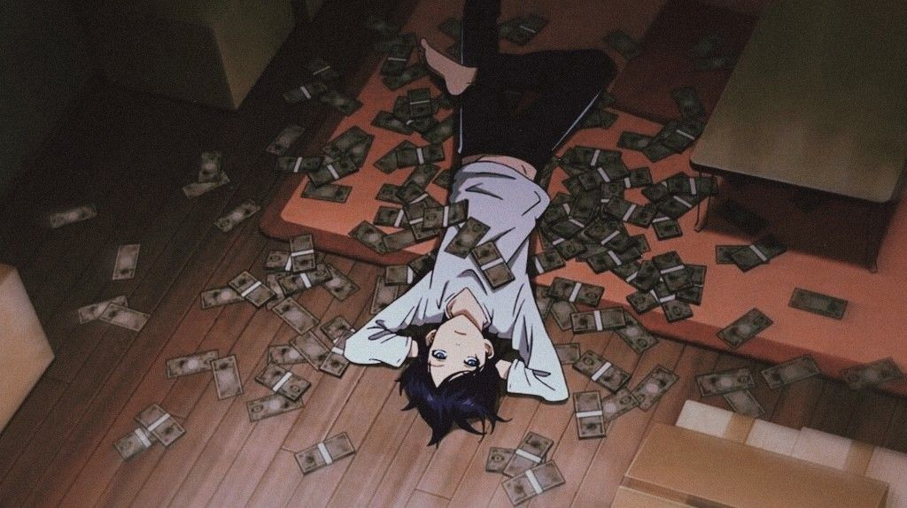

### you found the alt 👀 the real one's here → **[@z3zZ](https://github.com/z3zZ)**

 

# 📏 6'4"
code reviews are literally done from above

# 😮‍💨 HANDSOME
it's a burden. he carries it.

# 💸 RICH
(loading... 87%) — see banner for preview build

# 🌙 NIGHT OWL
best commits happen after midnight, no further questions

# 🪄 CODE = MAGIC
not LEGO. magic. he will correct you.

# 🏙️ CANARY WHARF BOUND
skyrise, city view, very good wi-fi

# 🧪 SHIPS SIDE PROJECTS LIKE IT'S CARDIO
klokd · inkd · errnd · rewnd — vowels not included

 

**excited by the idea, satisfied by the result.**

 

